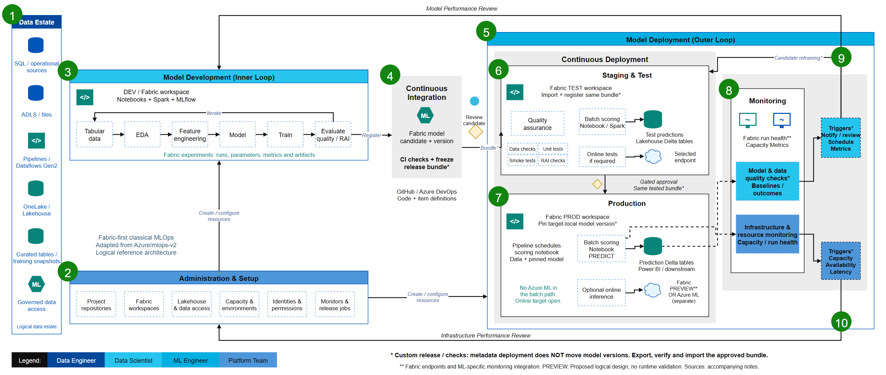

# Fabric classical ML architecture

This guide explains the ten stages in the Fabric-first adaptation of the
[Azure MLOps v2 classical ML reference](https://github.com/Azure/mlops-v2/blob/main/documentation/architecture/classical.md).
The lifecycle is preserved, but Azure ML services are not simply renamed as
Fabric services.

**Scope:** proposed logical architecture. Owners below are suggested roles,
not assignments. Tests and automation described below are requirements to
implement, not reported execution results.

## 1. Data estate

**Primary owner:** Data Engineer.

Bring governed operational data, files and other appropriate sources into the
analytical workflow using connectors, pipelines or another supported access
pattern. Organize training and scoring tables in Lakehouse/OneLake. Select
copying, shortcuts or other connectivity per source rather than assuming one
pattern works for every dataset.

Create reproducible training inputs: record the dataset reference, extraction
or snapshot time, schema and feature-preparation version. Apply the required
access controls and retention rules. A common OneLake namespace is not
permission for unrestricted cross-workspace access.

**Output:** documented source-to-feature path and traceable training/scoring
inputs. **Evidence:** schema/data-quality checks and verified run-identity access.

## 2. Administration and setup

**Primary owner:** Platform Team, with Data and ML Engineers.

Prepare source repositories, Fabric dev/test/prod workspaces, capacity,
notebook environments, run identities, item/data permissions and operating
ownership. Define CI/CD responsibilities, connection bindings, alert handling,
and approval authority.

A notebook's workspace identity requires the applicable tenant settings and
permissions. Workspace access does not itself grant access to every source.
Target environments must not silently continue using development connections.

If Azure ML is selected for online inference, provision and govern its separate
workspace and endpoint resources. Do not introduce Azure ML infrastructure for
the baseline Fabric batch path.

**Output:** environment and access configuration. **Evidence:** least-privilege
access tests, target bindings and workload-specific capacity/network decisions.

## 3. Model development: inner loop

**Primary owner:** Data Scientist, supported by ML Engineers.

Use Fabric notebooks and Spark for exploratory analysis, feature engineering,
model training and evaluation. Record runs, parameters, metrics, model files
and other artifacts in Fabric MLflow experiments.

Evaluate on appropriate held-out data and relevant slices. Perform responsible-AI
checks appropriate to the use case; the diagram does not claim those checks
are automatic or certify fairness/compliance.

Register an evaluated candidate in a Fabric ML model item. Include a populated
input/output signature and record code, environment and training-data references.
PREDICT compatibility must be checked against the actual model and runtime.

**Output:** registered candidate and evaluation evidence. **Evidence:** reproducible
run references, agreed quality results, signature and dependency compatibility.

## 4. Continuous integration and candidate packaging

**Primary owner:** ML Engineer.

Use the chosen GitHub or Azure DevOps workflow to review source and run code,
schema and dependency checks. Freeze the selected candidate into a controlled
release package containing model files and a release manifest.

The manifest should identify the candidate, code commit, model package hash,
signature, environment references, training-data reference and test evidence.
Keep large model files in approved protected artifact storage, not implicitly
inside the Git source tree. Never package credentials.

**Critical distinction:** Fabric ML Git/deployment integration is documented
as preview and tracks/promotes supported metadata only. It does not move
experiment runs or trained model versions.

**Output:** reviewed source plus a traceable candidate bundle.
**Evidence:** CI results and package integrity; the export/transport automation
is custom work to build and validate. See [model release](../model-release.md).

## 5. Model deployment: outer loop

**Primary owner:** ML Engineer, with an explicitly designated approver.

Coordinate two delivery paths:

- Deploy supported notebook, environment, configuration and item definitions.
- Separately transfer and register the trained-model package.

Bind resources to the correct target workspace. Target-local model identifiers
and version numbers can differ from DEV: consumers must resolve the explicit
release mapping rather than assume that version `1` means the same model
everywhere.

Advance through test, approval and production in a controlled sequence. Item
deployment is not an atomic model release, an acceptance test or an approval
mechanism on its own.

**Output:** release orchestration and version mapping.
**Evidence:** both delivery paths converge on the approved package/configuration.

## 6. Staging and test

**Primary owner:** ML Engineer with Data Scientist and platform reviewers.

Deploy definitions into TEST, transfer the candidate package using authorized
identities, register a target-local model version, and resolve its dependencies.
Check hashes and behavior after registration.

Run the agreed data checks, unit tests, prediction/schema smoke tests and
use-case-specific quality/RAI checks. Exercise the scoring notebook with its
actual identity, data and runtime. Validate retries, timeouts and output handling.

If online inference is required, test the chosen endpoint separately for
authentication, request schema, representative load and relevant network rules.

The candidate-retraining arrow represents a controlled job that trains a
candidate and submits it for testing. A retrained candidate needs fresh
evaluation; it is not automatically the previously approved package.

**Output:** test evidence bound to the candidate package hash.
**Evidence:** agreed acceptance criteria met; missing evidence remains a blocker.

## 7. Production deployment

**Primary owner:** ML Engineer and operating team.

After explicit approval, import the **same tested package** into PROD, register
the target-local version, and pin consumers to the correct model/configuration.
Smoke-test before enabling the production schedule or routing traffic.

### Batch path

A Fabric pipeline runs a notebook that applies Spark PREDICT to authorized
Lakehouse inputs. Publish prediction Delta tables for Power BI or downstream
consumers. Include the model/release identity and scoring timestamp with outputs.

Specify retry/idempotency behavior so a failed run cannot silently duplicate
or partially publish results. No Azure ML batch endpoint is required.

### Optional online path

Choose online serving only where the workload requires it:

| Option | Decision factors |
| --- | --- |
| Fabric ML model endpoint | Preview acceptance, supported flavor/schema, capacity behavior, latency, authentication and network requirements |
| Azure ML managed online endpoint | A separately governed Azure workspace; compatible registered MLflow package, runtime, access and operational requirements |

Fabric currently documents online endpoints, so "Fabric has no online serving"
is not a valid reason by itself to select Azure ML. Conversely, Azure ML is not
automatically a solution to every incompatible flavor or operational constraint.

No synchronous OneLake feature lookup is assumed. If online feature serving is
needed, separately design freshness, feature storage and training-serving parity.

**Output:** version-pinned scoring configuration and rollback target.
**Evidence:** production smoke tests, approved release record and restore procedure.

## 8. Monitoring

**Primary owner:** ML Engineer and Platform Team; Data Scientist for model quality.

Separate operational health from prediction quality.

Operational monitoring covers notebook/pipeline execution, capacity usage,
throttling and failures. Use appropriate endpoint telemetry if online serving
is deployed. Fabric's ML-specific Monitoring hub integration is documented as
preview; confirm availability and supported metrics.

Custom model/data checks can compare input statistics with agreed baselines,
check missingness or schema changes, and evaluate predictions against outcomes
when labels arrive. Define label delay, slices, thresholds and ownership.

A successful run, endpoint request count or low latency is not evidence of
model accuracy. The custom quality checks shown are not implemented here.

**Output:** operational signals and separately interpreted quality metrics.
**Evidence:** known injected failures and quality signals reach their owners.

## 9. Model/data events and actions

**Primary owner:** Data Scientist and ML Engineer.

Use schedules or agreed monitoring thresholds to initiate review, investigation
or candidate retraining. A drift signal is not proof that a replacement model
will improve outcomes.

Send the resulting candidate back through development as needed, then testing
and release approval. Never wire a monitoring alert directly to unconditional
production model replacement.

**Output:** an investigation or evaluated new candidate.
**Evidence:** the alert-to-candidate path retains test and approval gates.

## 10. Infrastructure events and actions

**Primary owner:** Platform Team.

Route capacity pressure, run reliability problems and endpoint availability or
latency issues to platform operations. Investigate identity, configuration,
capacity, dependency and connectivity causes before changing infrastructure.

Approved changes return through the setup process, with relevant smoke tests
and rollback arrangements. Neither the diagram nor this repository enables
automatic configuration changes.

**Output:** an operational incident or approved configuration change.
**Evidence:** traceable remediation and restored workload behavior.

## Before implementation

Resolve region, residency, model flavor, runtime, capacity, connectivity,
identity, recovery, performance and preview-policy requirements. Complete the
[validation checklist](../validation.md), then implement the custom mechanisms.

All technical references and the research date are in [sources](../sources.md).
